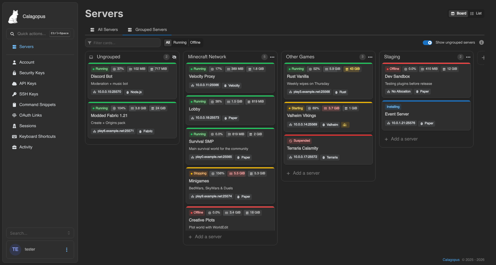
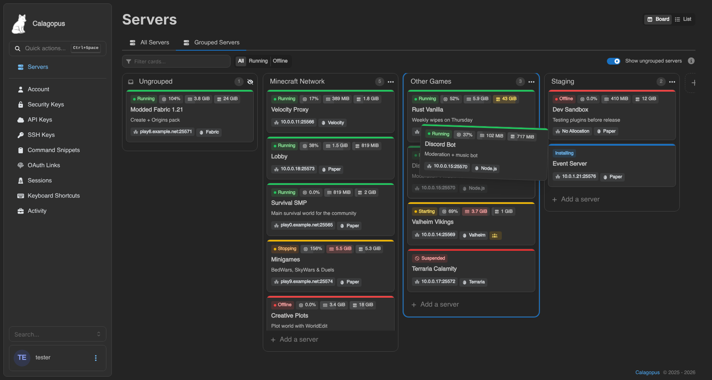
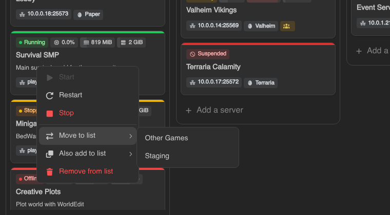
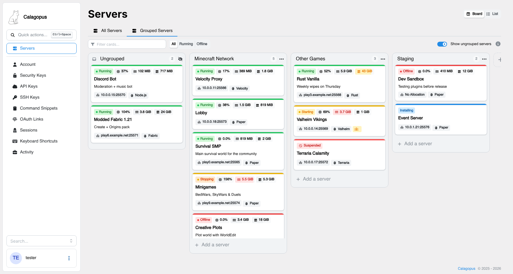

# Kanban Servers for Calagopus

[](https://github.com/XCraftTM/calagopus-kanban-servers/releases/latest)

A [Calagopus Panel](https://calagopus.com) extension that turns the **Grouped Servers** page into a
Trello-style Kanban board. Each server group becomes a list, each server becomes a card, and you organize
them by dragging.



## Features

- **Lists and cards like Trello.** Server groups are lists side by side, servers are cards inside them.
- **Drag and drop.** Move cards between lists, reorder cards inside a list, and drag a list by its header
  to reorder lists. Everything is saved to your account immediately.
- **Compact cards that keep the details.** The top row shows the power state, CPU, memory and disk as
  small chips. Each usage chip fills up as the server gets close to its limit and turns yellow or red, and
  hovering it shows the exact usage and limit. Below are the name, description, address (click to copy),
  egg, and a badge for servers owned by another user.
- **Ungrouped list.** An optional first list holds your servers that are not in any group yet. Drag them
  into a list, or drop a card here to take it out of its list.
- **Card actions.** Right-click a card or use its `…` button to start, restart, stop or kill it, move it
  to another list, also add it to another list, or remove it from the list.
- **List actions.** Click a list title to rename it. The list menu adds servers, selects all cards,
  collapses the list into a slim bar, gives it a color, powers every server in it, or deletes it.
- **List colors.** Pick one of the presets or any custom color with the color picker. A colored list gets
  a colored top bar and a slight tint of its color in the background.
- **Add lists and servers inline.** "Add another list" sits at the end of the board, and every list has an
  "Add a server" composer at the bottom.
- **Filter the board** by name, description, egg, node or address, and show only running or offline servers.
- **Bulk power actions** work like on the stock page: tick cards with their check button, or hold `S` and
  click them.
- **Switch back any time.** The Board / List toggle next to the page title returns to the stock grouped
  view. The choice is saved per user.

| Dragging a card | Card menu |
| --- | --- |
|  |  |



## Installation

Requires Calagopus **1.2.3 or newer** and a setup that can build extensions (the `heavy` Docker images or a
development environment).

1. Download `dev_xcrafttm_kanbanservers.c7s.zip` from the
   [latest release](https://github.com/XCraftTM/calagopus-kanban-servers/releases/latest).
2. Upload it in **Admin → Extensions**, or put it into `./build/extensions` and run
   `docker compose restart web`. In a development environment use
   `panel-rs extensions add dev_xcrafttm_kanbanservers.c7s.zip` and `panel-rs extensions apply`.
3. Open **Servers → Grouped Servers**.

To update, replace the archive with the new one. There is nothing to configure.

## FAQ

**Where is my data stored?**
The board uses the panel's own server groups, so lists, card order and list order are the same data the
stock page uses. List colors (a preset name or a hex code), collapsed lists, the Ungrouped toggle and the Board/List choice are stored as
your user settings.

**Can a server be in more than one list?**
Yes, like in the stock page. Use "Also add to list" in the card menu. Dragging a card always moves it.

**Why can't I drop a card into a list?**
The list already contains that server, or it is full (a group holds at most 100 servers). The list shows a
notice while you hover it.

**Does it work with themes?**
Yes. It was tested with the qunix theme, which moves the page tabs into its own toolbar and hides the page
header. In that case the board keeps the tabs where the theme put them and shows the Board/List toggle at the
right end of its own toolbar. The theme's own list/grid and Customize buttons only affect the stock view.

**Does disabling the extension break anything?**
No. The page goes back to the stock grouped view, and your groups are untouched.

---

## Technical notes

The extension is frontend-only. Its Rust crate is an empty `ExtensionStruct`, because everything goes
through the panel's existing server group API (`/api/client/servers/groups/...`).

### How the board replaces the page

`index.tsx` registers a props interceptor on `pages.dashboard.home.containerGrouped`. The interceptor
replaces the container's `children` with `KanbanSwitch` and appends the Board/List toggle to
`contentRight`. `KanbanSwitch` renders the board, or the original children when the user picked the list
view. No core module is overridden, so disabling the extension restores the stock page.

Themes can rearrange the page before this interceptor runs. If the incoming children no longer contain the
stock `DashboardHomeTitle` (a theme moved the tabs elsewhere), the board doesn't render its own copy. If
`hideTitleComponent` is set (the header and `contentRight` are hidden), the toggle is rendered inline instead.

List width is measured, not hard-coded: `ListWidthProbe` renders the widest realistic chip row off-screen
(longest status label, `999%`, two `1023 MiB` chips) and the lists become exactly wide enough for it, but at
least 20rem. A `ResizeObserver` and `document.fonts.ready` re-measure when a theme's web font arrives late.

### Layout

```text
frontend/src/
  index.tsx                  registers the interceptor
  translations.ts            extension strings (core strings are reused where they exist)
  lib/
    api.ts                   fetches a whole group (100 per page = the group limit) and your own servers
    constants.ts             package name, query keys, user setting keys, limits
    useBoardData.ts          groups, per-list queries, server lookup map, ungrouped list
    useBoardActions.ts       move/add/remove/reorder/rename/create/delete with optimistic updates + rollback
    useBoardDnd.ts           dnd-kit state for cards across lists and for list reordering
  elements/
    KanbanSwitch.tsx, ViewToggle.tsx
    board/KanbanBoard.tsx    toolbar, selection, filters, DnD board
    board/BoardList.tsx      a list with header menu, cards and composer
    board/ServerCard.tsx     the card and its menu
    board/Chip.tsx, CollapsedList.tsx, CardComposer.tsx, AddListColumn.tsx
```

### Drag and drop

The board uses the panel's `DndBoard`, `DndSortableList` and `SortableItem` elements (dnd-kit). While a
card is dragged, `useBoardDnd` keeps a draft copy of every list and moves the card between lists on
`dragOver`, so the target list opens a gap at the pointer. On drop the draft is committed:

- same list: the new order is saved with `PATCH /groups/{uuid}`,
- another list: the target list is saved first, then the source list, so a failure halfway leaves the
  server in both lists rather than in none,
- to or from Ungrouped: only the group side is saved.

The store is updated before the request, which makes the drop instant. Errors show a toast and roll back.
Lists are reordered with `PUT /groups/order`. New lists are appended to the end of that order.

### Building

```bash
python3 scripts/package.py   # writes dist/dev_xcrafttm_kanbanservers.c7s.zip
```

CI builds the archive on every push. Running the **Build Extension** workflow with **release** ticked on
`main` (or pushing a `vX.Y.Z` tag) publishes a GitHub release with the section of `CHANGELOG.md` that
matches the version in `Cargo.toml`.

To check the code, copy the repository into a panel checkout as `backend-extensions/dev_xcrafttm_kanbanservers`
(with the `frontend/extensions/<id>` and `backend-extensions/node_modules` links that `panel-rs extensions add`
creates), then run `pnpm typecheck`, `pnpm biome:validate` and `pnpm build` in `frontend/`, and
`SQLX_OFFLINE=true cargo clippy -p dev_xcrafttm_kanbanservers -- -D warnings`.
